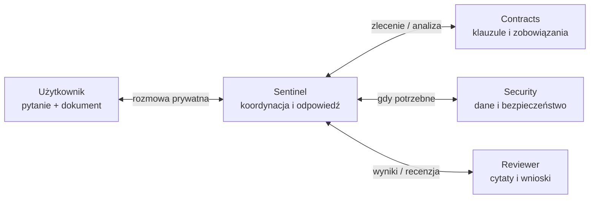

# Contract Sentinel

**Nowa umowa nie kasuje starych zobowiązań. Nasze boty znajdują konflikt, zanim ją podpiszesz.**

Czy nowa umowa z dostawcą albo terms & conditions nowego narzędzia nie są sprzeczne z umowami, które firma już podpisała? To powtarzalny problem wielu firm kupujących oprogramowanie, korzystających z AI i zatrudniających podwykonawców. Administracja porównuje dokumenty, a niejasności wracają jako kolejne pytania do prawników.

Zespół chce kupić narzędzie do kopii zapasowych. Dostawca wymaga przechowywania danych przez **180 dni**. Umowa z klientem każe usunąć je **w ciągu 15 dni od zakończenia współpracy**. Kto połączy te dwa zapisy?

Contract Sentinel robi to w **Grok Bot**. Użytkownik załącza dokument i zadaje zwykłe pytanie. Sentinel sam zleca analizę innym botom, zbiera wyniki i uruchamia recenzję. Oddaje **wniosek, cytaty i konkretny następny krok**.

## Co pokazaliśmy w działającym demo

| Krok użytkownika | Wynik zespołu botów |
| --- | --- |
| „Czy ta umowa pasuje do naszych zobowiązań?” | Wykryty konflikt: DemoVault §3 kontra umowa Firmy B §6.3. Propozycja zmiany warunków. |
| „Dostawca proponuje taką zmianę. Czy rozwiązuje wskazany problem?” | Ocena zmieniona na **warunkowo pozytywną**: po uzgodnieniu aneksu usunięcie na żądanie w 7 dni. |
| Co trzeba zrobić dalej? | Żądanie otrzymane do **23 listopada** pozwala dotrzymać terminu **30 listopada** w scenariuszu. Pozostają zwrot danych i potwierdzenie usunięcia. |

**Wartość biznesowa: oszczędność czasu administracji i ograniczenie kosztów konsultacji prawnych.** System wykonuje wstępne porównanie, wskazuje cytaty i proponuje następny krok. Administracja nie zaczyna od przeszukiwania całej paczki umów; do prawnika może skierować konkretne wyjątki i pytania wymagające rozstrzygnięcia. To mechanizm ograniczenia ręcznej pracy i rutynowych konsultacji — skalę oszczędności zweryfikujemy w pilotażu. PoC nie mierzył jeszcze ROI; decyzja pozostaje po stronie człowieka.

## Cztery boty. Jeden rozmówca dla użytkownika.

Sentinel deleguje zadania **automatycznie**, bez poleceń użytkownika dla poszczególnych botów. Zbiera analizy i przekazuje je Reviewerowi przed odpowiedzią. W próbie DemoVault v1 pracowały wszystkie cztery boty; przy aneksie wystarczyły Contracts i Reviewer.

**To działający PoC, nie automatyczna zgoda na podpisanie umowy.** Rozmowy i delegacje odbyły się w Grok Bot. DemoVault, aneks i daty są fikcyjnymi materiałami testowymi; umowa Firmy B pochodzi z zanonimizowanej paczki. Ograniczenia i poprawki zachowujemy w [dzienniku prób](GROKBOT_STARTER/POSTEP_DEMO.txt).

Wrocław · 5 listopada 2026 · track: **Multi-agent systems**

<strong>Odtwórz demo i sprawdź materiały</strong>

### Uruchomienie w Grok Bot

Repo zawiera konfigurację agentów, dokumenty i scenariusze. Działającym środowiskiem jest aplikacja Grok Bot.

1. Przeczytaj [opis danych](CZYTAJ_NAJPIERW.txt) i [instrukcję startową](GROKBOT_STARTER/START.txt).
2. Utwórz boty według [promptów](GROKBOT_STARTER/PROMPTY.txt), dodaj [reguły biznesowe](GROKBOT_STARTER/ROZSZERZENIE_BIZNESOWE.txt) i jednorazowo wdróż [HARNESS](GROKBOT_STARTER/HARNESS.txt). Sam plik w repo nie aktywuje reguł w aplikacji.
3. Udostępnij botom bazę dokumentów. Wybierz jeden format każdej umowy, aby nie wczytywać TXT i PDF podwójnie.
4. Prywatnie do Sentinela wyślij [DemoVault v1](GROKBOT_STARTER/DEMOVAULT_UMOWA_v1.txt) i [kontekst zakupu](GROKBOT_STARTER/DEMOVAULT_KONTEKST.txt). Po odpowiedzi doślij [proponowany aneks v2](GROKBOT_STARTER/DEMOVAULT_ANEKS_v2.txt).

[Oczekiwania operatora](GROKBOT_STARTER/DEMOVAULT_TEST_OPERATORA.txt) służą ocenie wyniku — nie podawaliśmy ich botom.

### Co rzeczywiście przetestowaliśmy

- DemoVault v1: wykrycie konfliktu i propozycja zmiany; odpowiedź po **6 min 34 s**.
- DemoVault v2: ponowna ocena po aneksie; odpowiedź po **4 min 25 s**.
- Pytanie o case study i logo Firmy B oraz aktualizacja odpowiedzi po [fikcyjnej zgodzie](GROKBOT_STARTER/DEMO_ZGODA_MARKETINGOWA_B.txt).
- [Porównanie Claude Code Pro/Team](GROKBOT_STARTER/CLAUDE_CODE_SCENARIUSZ.txt) z [oficjalnymi źródłami](GROKBOT_STARTER/CLAUDE_CODE_ZRODLA.txt) i kolejnymi korektami odpowiedzi.

Pełny przebieg, czasy i zauważone błędy: [POSTEP_DEMO.txt](GROKBOT_STARTER/POSTEP_DEMO.txt). Nie mierzyliśmy jeszcze oszczędności czasu względem pracy człowieka. Skrócenie oczekiwania w montażu filmu nie oznacza odpowiedzi w czasie rzeczywistym.

### Dane i granice PoC

- [Umowy](Umowy/): trzy zanonimizowane historyczne umowy; część tekstu pochodzi z OCR.
- [ISO](ISO/): sześć opracowań edukacyjnych, nie tekst normy ani obowiązujące polityki firmy.
- [GROKBOT_STARTER](GROKBOT_STARTER/): prompty, procedura pracy, scenariusze i kryteria oceny.
- [MANIFEST.json](MANIFEST.json): sumy kontrolne dostarczonej paczki.

Recenzja nie wyeliminowała wszystkich błędów. W DemoVault odnotowaliśmy niejasność granicy 180 dni oraz pominięcie możliwości samodzielnego usunięcia kopii w odpowiedzi o aneksie. Warunkowy wynik dotyczy wskazanego konfliktu i faktów scenariusza, nie akceptacji całej umowy ani potwierdzenia zgodności z ISO.

HARNESS v1.1 został wdrożony według potwierdzeń botów; trwałość reguł w nowym kontekście pozostaje nieprzetestowana. Dzisiejsze wejście i wyjście to prywatny czat Sentinela. Slack, webhooki i harmonogramy są [kierunkiem dalszej pracy](GROKBOT_STARTER/WEJSCIE_WYJSCIE_DEMO.txt), nie częścią wykonanego demo. Prywatna konfiguracja integracji firmowych pozostaje poza repo.

Repo jest przeznaczone do pracy prywatnej. Anonimizacja nie rozstrzyga możliwości publicznego udostępnienia warunków umownych.

