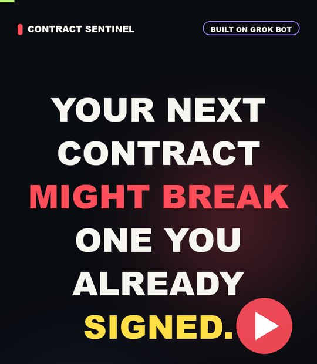
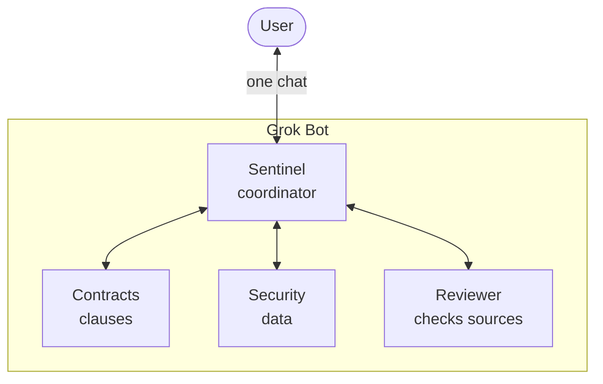

# Contract Sentinel

### Your next contract may break one you already signed. Four Grok Bot agents catch it before you sign.

▶ **[Watch the 58-second demo video](media/Contract-Sentinel-TikTok-EN.mp4)**

**The question every company asks, again and again:** do the new supplier contract, or the terms & conditions of the new SaaS / AI tool, conflict with what we already promised our clients?

Every company that buys software, adopts AI tools or hires subcontractors has this problem. Today someone in admin reads the documents side by side, and every unclear clause becomes another question for a lawyer. That is slow, it costs money, and it is easy to miss something.

## What Grok Bot does here

- **One chat, a whole team behind it.** The user only talks to Sentinel. Sentinel decides which specialists to involve and hands the work over through **real Grok Bot bot-to-bot messages**. Each message wakes up the next bot. Nobody prompts the specialists by hand.
- **Shared knowledge base.** The signed contracts are stored once in Grok Bot's shared files, and every bot works from the same sources.
- **A built-in second opinion.** Reviewer opens the original documents again and marks each finding *keep / soften / reject / needs evidence* before anything reaches the user.
- **Taught once, applied every time.** The work rules (*HARNESS v1.1*: verbatim quotes, who is bound by a clause, "no proof of consent" is not "no consent") are deployed to all four bots as a persistent procedure. Users ask plain questions without any prompt engineering.

## Results from real Grok Bot runs today

| The user asked | The bots answered | Time |
|---|---|---|
| "Can we sign this backup contract? Does it fit our client commitments?" | **Conflict found:** DemoVault §3 vs Client B §6.3, with both clauses quoted and a change to negotiate | 6 min 34 s · 4 bots |
| "The vendor offers this amendment. Does it fix the problem?" | **Conditional yes:** the deletion request must arrive by **23 Nov** to meet the **30 Nov** deadline | 4 min 25 s · 2 bots |
| "Can we publish a case study with Client B's logo?" | Quotes §11.7 and tells "no proof of consent" apart from "consent refused" | 4 min 20 s |

## The business case

- **Admin saves time.** Instead of reading a stack of contracts, admin gets a verdict with clause numbers and quotes, plus the next step.
- **Fewer questions to lawyers.** Routine checks are closed by the bots. Lawyers get only the specific exceptions that need a legal decision, not "please read all of it".
- **The cost scales well.** A new tool, a new supplier or a changed T&C costs a few minutes of agent work, not another manual review.
- **People stay in control.** Contract Sentinel prepares the decision and a person makes it.

Next step: the admin team drops a contract into Slack, a Grok Bot routine starts the same team, and the report comes back in the thread.

Wrocław · 5 Nov 2026 · Track: **Multi-agent systems** · Built with **Grok Bot**

<strong>Reproduce the demo, data and honest limits</strong>

### Run it in Grok Bot

1. Read the [data notes](CZYTAJ_NAJPIERW.txt) and the [starter guide](GROKBOT_STARTER/START.txt).
2. Create the four bots from [PROMPTY.txt](GROKBOT_STARTER/PROMPTY.txt), add the [business rules](GROKBOT_STARTER/ROZSZERZENIE_BIZNESOWE.txt) and deploy [HARNESS](GROKBOT_STARTER/HARNESS.txt) once. Having the file in the repo does not activate the rules in the app.
3. Give the bots the document base. Use one format per contract (TXT or PDF), not both.
4. In a private chat with Sentinel, send [DemoVault v1](GROKBOT_STARTER/DEMOVAULT_UMOWA_v1.txt) with the [purchase context](GROKBOT_STARTER/DEMOVAULT_KONTEKST.txt). After the answer, send the [amendment v2](GROKBOT_STARTER/DEMOVAULT_ANEKS_v2.txt).

The [operator expectations](GROKBOT_STARTER/DEMOVAULT_TEST_OPERATORA.txt) were used to grade the answers and were never shown to the bots.

### What we actually tested

The full run log, timings and errors we found are in [POSTEP_DEMO.txt](GROKBOT_STARTER/POSTEP_DEMO.txt). It also covers a [Claude Code Pro vs Team + DPA comparison](GROKBOT_STARTER/CLAUDE_CODE_SCENARIUSZ.txt) against [official sources](GROKBOT_STARTER/CLAUDE_CODE_ZRODLA.txt).

### Data and limits of the PoC

- [Umowy/](Umowy/): three anonymised historical client contracts. Part of the text comes from OCR.
- [ISO/](ISO/): six educational summaries. They are not the ISO standard and not company policy.
- DemoVault, its amendment and all dates are fictional test material.
- The PoC has not measured savings yet. The mechanism works end to end, and a pilot will put numbers on it. The demo video shortens the waiting time; answers are not real-time.
- Reviewer did not catch every error. We logged the 180-day boundary ambiguity and one omitted self-deletion option.
- The input and output today is Sentinel's private chat. Slack, webhooks and schedules are [future work](GROKBOT_STARTER/WEJSCIE_WYJSCIE_DEMO.txt). Company integrations stay out of the repo.

